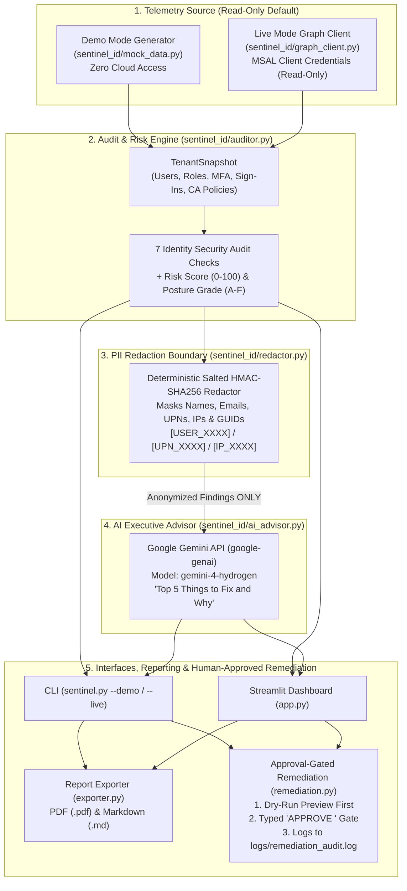

# 🛡️ Sentinel ID — AI-Assisted Identity Security Auditor for Microsoft Entra ID

**Sentinel ID** is a Python 3.11+ cloud identity posture auditing tool and executive risk translator for **Microsoft Entra ID** (formerly Azure AD). It evaluates a tenant across **7 high-impact identity security controls**, redacts all Personally Identifiable Information (PII) locally using salted `HMAC-SHA256` tokens, and uses the **Google Gemini API (`google-genai` Interactions API)** to translate technical findings into a plain-English **"Top 5 Things to Fix and Why"** executive brief for non-technical leadership.

It ships with both an **interactive Streamlit Security Dashboard** (`app.py`) and a **rich Command-Line Interface** (`sentinel.py`), plus an optional **Dry-Run First, Human-Approval-Gated Remediation Engine**.

---

## ✨ What It Does

1. **Demo Mode First (Zero Cloud Access Required):** Generates a realistic enterprise Entra ID mock tenant (*Northwind Cloud Lab*) with 18 user principals, directory role assignments, sign-in histories, MFA registration details, risky sign-ins, licenses, group memberships, and Conditional Access policies so the entire dashboard, CLI, report exporter, and test suite run offline out of the box.
2. **7 Automated Identity Security Audit Checks:**
   - **Check 1 — Users Without MFA Registered:** Flags active administrators, member users, and external guests lacking Multi-Factor Authentication registration.
   - **Check 2 — Stale Accounts (90+ Days Inactive, Configurable):** Identifies active accounts with no sign-in for 90+ days (or accounts created 90+ days ago that have never signed in).
   - **Check 3 — Privileged Directory Roles & Excess Admins:** Alerts when permanent Global Administrators exceed recommended limits (`> 4`) and flags standing privileged role holders with weak MFA, inactivity, or non-IT business titles.
   - **Check 4 — Risky Sign-Ins & Risky Users (Entra ID P2):** Audits Entra ID Identity Protection telemetry (`leakedCredentials`, `anonymizedIPAddress`, `impossibleTravel`, `passwordSpray`) and **skips gracefully** if the tenant license does not include Entra ID P2.
   - **Check 5 — Old or Inactive Guest Accounts:** Flags external B2B guest principals (`#EXT#`) that are dormant or never accepted invitations while retaining internal group memberships.
   - **Check 6 — Conditional Access Policy Gaps (Read-Only Review):** Detects Admin MFA policies stuck in `Report-Only` mode (`enabledForReportingButNotEnforced`), disabled legacy authentication block policies, and excessive user exclusions on active MFA policies.
   - **Check 7 — Disabled Accounts Holding Licenses or Groups:** Identifies offboarded (`accountEnabled == false`) accounts that still consume paid Microsoft 365 / Power BI licenses or remain in security groups.
3. **Deterministic PII Redaction Before AI:** Hashes and masks all user display names, email addresses, UPNs, IP addresses, and directory GUIDs into `[UPN_XXXXXXXX]`, `[USER_XXXXXXXX]`, and `[IP_XXXXXXXX]` tokens before sending any context to Gemini.
4. **Plain-English AI Executive Summary:** Produces a business-focused *"Top 5 Priorities to Fix and Why"* brief for non-technical managers using `gemini-4-hydrogen` via the `google-genai` SDK (with an automatic offline executive summary fallback when no API key is configured).
5. **Approval-Gated Remediation (Off by Default, Dry-Run First):** Suggests targeted remediations (disable stale account, revoke sessions, remove from privileged role), previews the exact Microsoft Graph HTTP call and state diff as a **Dry Run first**, requires typing `APPROVE <target_upn>` per action, and writes an immutable JSONL audit record to `logs/remediation_audit.log`.
6. **PDF & Markdown Report Export:** Exports executive and technical audit reports to `.pdf` and `.md` from both the CLI and Streamlit dashboard.

---

## 🖼️ Screenshots (Placeholder)

> Replace the placeholders below with screenshots captured from your local environment (`docs/screenshots/`):

| Dashboard View | Screenshot Placeholder |
|---|---|
| **Executive Risk Overview & Severity Charts** | `` |
| **AI Executive Brief & PII Redaction Proof** | `` |
| **Approval-Gated Dry-Run Remediation Console** | `` |
| **CLI Terminal Output (`python sentinel.py --demo`)** | `` |

---

## 🏗️ System Architecture



---

## 📁 Project Structure

```text
sentinel-id/
├── .env.example                 # Template for environment variables (never commit .env)
├── .gitignore                   # Excludes .env, secrets, logs/, reports/, .venv/
├── README.md                    # Documentation, architecture & setup guide
├── requirements.txt             # Python 3.11+ dependencies
├── sentinel.py                  # CLI entrypoint (python sentinel.py --demo / --live)
├── app.py                       # Streamlit dashboard entrypoint (streamlit run app.py)
├── sentinel_id/
│   ├── __init__.py
│   ├── config.py                # Safe-by-default runtime configuration & permission manifests
│   ├── models.py                # Typed dataclasses for snapshots, findings, and remediations
│   ├── mock_data.py             # Realistic mock Entra ID tenant generator (Demo Mode)
│   ├── graph_client.py          # Read-only MSAL + Microsoft Graph client with P2 degradation
│   ├── auditor.py               # All 7 identity security audit checks & risk scoring engine
│   ├── redactor.py              # Salted HMAC-SHA256 PII redactor & regex text scrubber
│   ├── ai_advisor.py            # Gemini API (google-genai Interactions API) executive advisor
│   ├── remediation.py           # Dry-run first, typed-approval remediation engine & audit logger
│   └── exporter.py              # Markdown (.md) and PDF (.pdf) report exporters
└── tests/
    ├── __init__.py
    ├── test_auditor.py          # Unit tests for all 7 audit checks & graceful P2 license skipping
    ├── test_redactor.py         # Unit tests proving zero PII leakage in AI payloads
    └── test_remediation.py      # Unit tests for dry-run, typed approval gates, and exports
```

---

## 🚀 Setup & Quickstart — Demo Mode (Zero Cloud Access)

Demo Mode requires **no Microsoft Entra ID account** and **no cloud credentials**.

### 1. Create a Virtual Environment & Install Dependencies

```bash
python -m venv .venv

# Windows PowerShell:
.\.venv\Scripts\Activate.ps1

# macOS / Linux:
# source .venv/bin/activate

pip install -r requirements.txt
```

### 2. (Optional) Configure `.env` for Live Gemini AI Summaries

Copy `.env.example` to `.env`. If you add a `GEMINI_API_KEY`, Sentinel ID will send the **PII-redacted** findings to `gemini-4-hydrogen`. If left blank, Sentinel ID automatically uses its built-in offline executive summary synthesizer so Demo Mode works 100% offline.

```bash
cp .env.example .env
```

### 3. Run the CLI in Demo Mode

```bash
# Run full audit in Demo Mode
python sentinel.py --demo

# Preview the PII-redacted JSON payload sent to the AI model & export Markdown + PDF reports
python sentinel.py --demo --show-redacted --export-md reports/demo_audit.md --export-pdf reports/demo_audit.pdf

# Simulate a tenant without Entra ID P2 licensing (verifies Check 4 skips gracefully)
python sentinel.py --demo --no-p2-license

# Launch interactive dry-run + typed-approval remediation workflow in Demo Mode
python sentinel.py --demo --remediate
```

### 4. Launch the Streamlit Dashboard

```bash
streamlit run app.py
```

### 5. Run the Unit Test Suite

```bash
pytest -v
```

---

## ☁️ Setup for Live Mode (Personal Test Tenant ONLY)

> [!CAUTION]
> **Personal Test Tenant Only:** Live Mode is designed strictly for a personal Microsoft 365 Developer Program sandbox or personal Entra ID test tenant that you own. Never connect portfolio tools to a production or employer tenant.

### Step 1: Register a Read-Only App in Microsoft Entra ID

1. Sign in to the [Microsoft Entra Admin Center](https://entra.microsoft.com/) using your **personal test tenant**.
2. Navigate to **Identity** → **Applications** → **App registrations** → **New registration**.
3. Name the application `Sentinel-ID-Auditor-ReadOnly`, select **Accounts in this organizational directory only (Single tenant)**, and click **Register**.
4. Copy the **Application (client) ID** and **Directory (tenant) ID** from the Overview blade into your local `.env` file (`ENTRA_CLIENT_ID` and `ENTRA_TENANT_ID`).
5. Navigate to **Certificates & secrets** → **Client secrets** → **New client secret**. Copy the secret **Value** into `.env` (`ENTRA_CLIENT_SECRET`).

### Step 2: Grant Least-Privilege Read-Only Graph Permissions

1. In your App Registration, go to **API permissions** → **Add a permission** → **Microsoft Graph** → **Application permissions**.
2. Add **only** the following **Read-Only** permissions:

| Microsoft Graph Permission | Type | Purpose (Audit Check) |
|---|---|---|
| `User.Read.All` | Application (Read-Only) | Read user profiles, `accountEnabled`, `userType`, and `signInActivity` (Checks 1, 2, 5, 7) |
| `Directory.Read.All` | Application (Read-Only) | Read group memberships and assigned license SKUs (Checks 3, 5, 7) |
| `AuditLog.Read.All` | Application (Read-Only) | Read `signInActivity`, MFA registration reports, and risky sign-in logs (Checks 1, 2, 4) |
| `Policy.Read.All` | Application (Read-Only) | Read Conditional Access policies without modification (Check 6) |
| `RoleManagement.Read.Directory` | Application (Read-Only) | Read directory role definitions and active role members (Check 3) |
| `IdentityRiskyUser.Read.All` *(Optional)* | Application (Read-Only) | Read Entra ID P2 Identity Protection risky users; skipped gracefully if omitted or unlicensed (Check 4) |

3. Click **Grant admin consent for [Your Test Tenant]**.

### Step 3: Run Sentinel ID in Live Read-Only Mode

```bash
python sentinel.py --live --export-md reports/live_audit.md --export-pdf reports/live_audit.pdf
```

### Step 4: Separate Write Permissions (Optional Remediation Only — Not Requested by Default)

Sentinel ID **never** requests write permissions by default. If you choose to test live remediation on your personal test tenant (`SENTINEL_ALLOW_REMEDIATION=true`), the following separate permissions correspond to each approval-gated action:

| Remediation Action | Graph Endpoint | Separate Write Permission Required |
|---|---|---|
| Disable Stale Account | `PATCH /users/{id}` | `User.ReadWrite.All` |
| Revoke Active Sessions | `POST /users/{id}/revokeSignInSessions` | `User.ReadWrite.All` |
| Remove from Privileged Role | `DELETE /directoryRoles/{role_id}/members/{user_id}/$ref` | `RoleManagement.ReadWrite.Directory` |

---

## 🔐 Security Design Decisions

### 1. Read-Only by Default & Principle of Least Privilege
- All default workflows (`--demo`, `--live`, and the Streamlit dashboard) perform strictly **non-mutating GET queries**.
- Conditional Access evaluation (Check 6) is permanently read-only so an automated tool can never accidentally lock out administrators.
- Live remediation is gated behind both an explicit configuration flag (`SENTINEL_ALLOW_REMEDIATION=false` by default) and interactive human approval.

### 2. Deterministic PII Redaction Gate (`PIIRedactor`)
- Sending raw employee names, UPNs, email addresses, or IP addresses to an external LLM creates unnecessary data-privacy and compliance exposure.
- Before any prompt is constructed for the Gemini API, `PIIRedactor` replaces every known identifier and scrubs free-text descriptions via regex (`EMAIL_UPN_REGEX`, `IPV4_REGEX`) using a locally salted `HMAC-SHA256` digest (`[UPN_8F3A19C2]`, `[USER_4B91E0A1]`, `[IP_D182C004]`).
- Unit test `tests/test_redactor.py::test_ai_payload_contains_zero_raw_pii` asserts that zero raw names, UPNs, emails, IPs, or tenant domains appear anywhere in the serialized AI payload.

### 3. Dry-Run First + Per-Action Typed Human Approval Gate
- Automated identity remediation without human verification can cause production outages if a service account or executive account is disabled unexpectedly.
- Every proposed remediation in Sentinel ID executes a **Dry Run first** (`RemediationEngine.preview_dry_run()`), presenting the operator with:
  - The exact HTTP verb, Microsoft Graph endpoint, and JSON request body
  - The `Pre-Change State` vs. `Post-Change State` diff
  - The required Microsoft Graph write permission
- To execute an action, the operator must explicitly type `APPROVE <target_upn>` (for example, `APPROVE hannah.abbott@northwindlab.onmicrosoft.com`). Mismatched input is rejected.
- Every dry-run, approval, rejection, and execution is logged with an ISO-8601 UTC timestamp to `logs/remediation_audit.log`.

### 4. Secret Hygiene
- Credentials and API keys are loaded strictly from `.env` via `python-dotenv`.
- `.env`, `*.pem`, `*.key`, `*.pfx`, `logs/`, and `reports/` are excluded in `.gitignore`.
